# 国内银联卡充值ChatGPT Plus教程（2026亲测）

> 最后更新：2026 年 8 月 · 华为手机实测，13 张截图全流程

**这篇教程解决一个问题：没有海外信用卡，如何用国内银联储蓄卡直接开通 ChatGPT Plus。** 原理是通过 Google Play（新加坡区）绑定国内银联卡完成订阅付款——不需要 Visa/Mastercard，不需要虚拟卡，不需要海外礼品卡。全程亲测成功，每一步都有截图。

适合人群：有稳定新加坡节点、愿意折腾 Google Play 的用户。如果你想直接用支付宝/微信付款、几分钟搞定，看[文末的省事方案](#嫌麻烦还有更省事的路)。

## 准备条件

首先确认两个准备条件：

1. 有新加坡的节点，操作过程中全程开启不要中断（很重要！）
2. Google Play 和 ChatGPT 的账号一致，都用同一个 Google 账户登陆

用到的 APP：Google Play、出境易、ChatGPT

我的手机型号：Huawei Mate 70pro+，手机系统：Harmony OS 4.3.0

## 具体步骤

### 1. 登陆 Google Play

新加坡节点全程开启，手机浏览器搜索 Google Play → 点击进入官网 → 点击官网右上角灰色的头像 → 点击【使用 Google 账号登录】。

注意：登陆一定要和 ChatGPT 一样的 Google 账号。

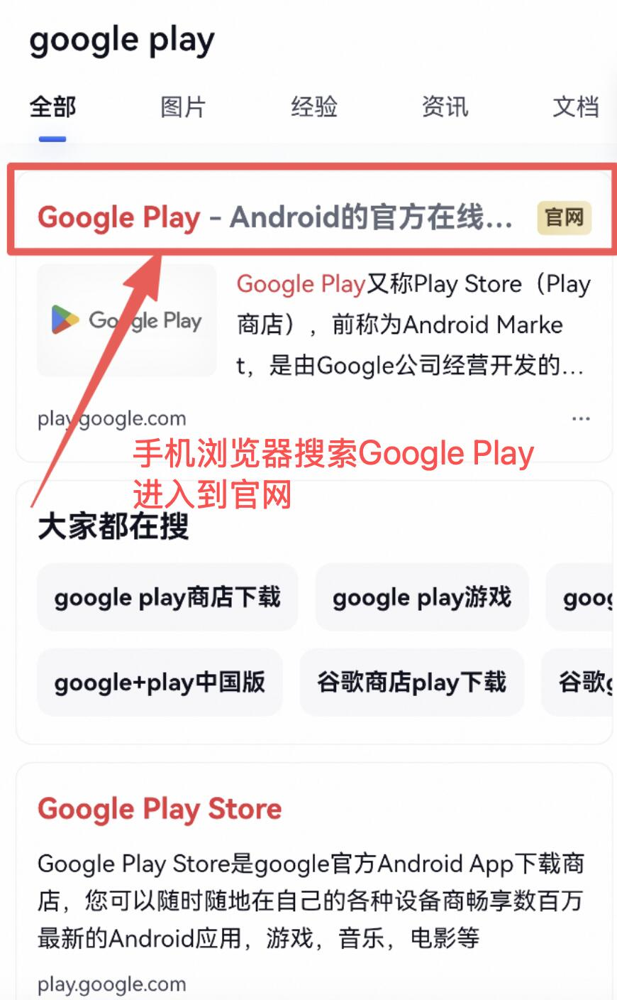

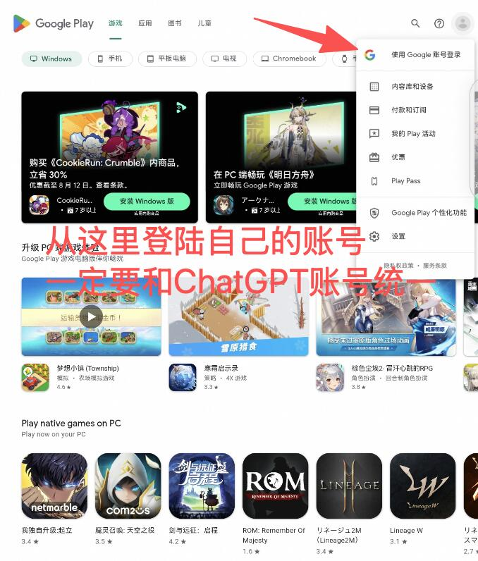

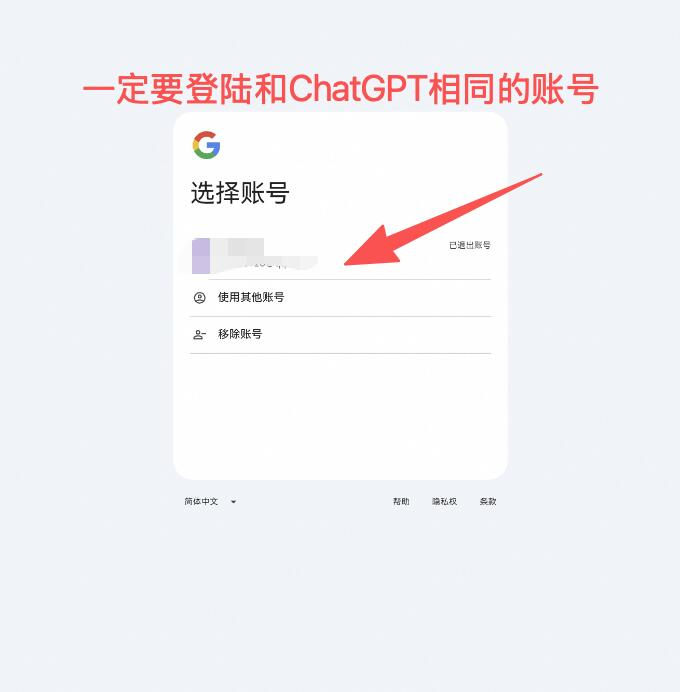

### 2. 确认地区

同样是在官网首页 → 点击已登陆的右上角头像 → 点击设置 → 确认【国家/地区和个人资料】模块的地区是否显示为新加坡。

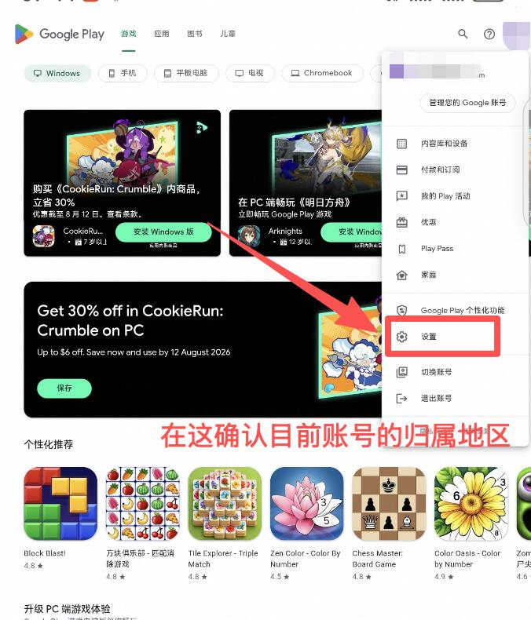

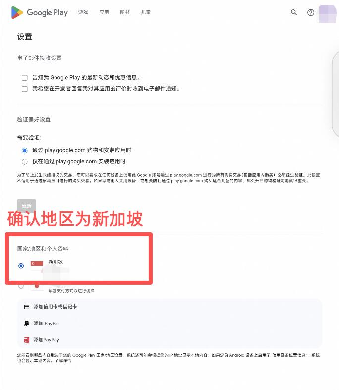

### 3. 添加国内银联银行卡

一个入口是在步骤二的地区下面，有一个【添加信用卡或借记卡】的地方，直接填写卡号和绑定的手机号，点击继续，会有一个验证码需要验证，填写手机收到的验证码即可，就可以绑定自己的国内储蓄卡了。

（还有另一个入口是在 Google Play 首页头像点击后出现的【付款和订阅】的入口，点进去在【支付方式】下面点击【添加信用卡或借记卡】，后面步骤同上）

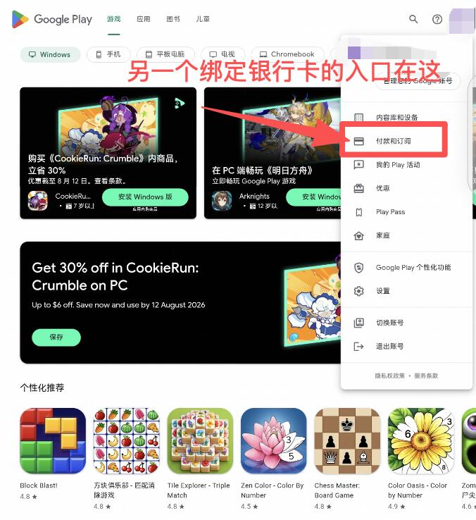

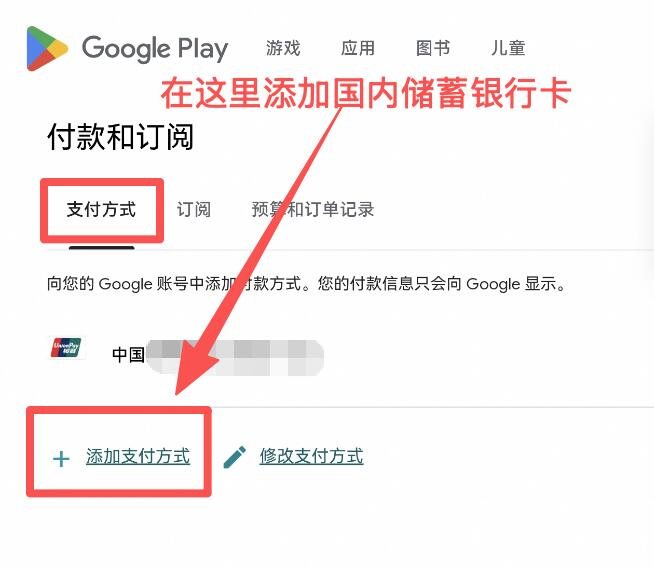

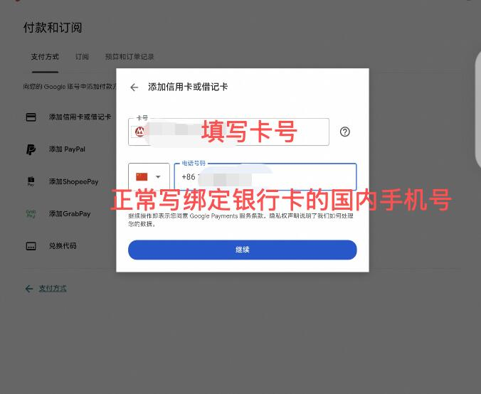

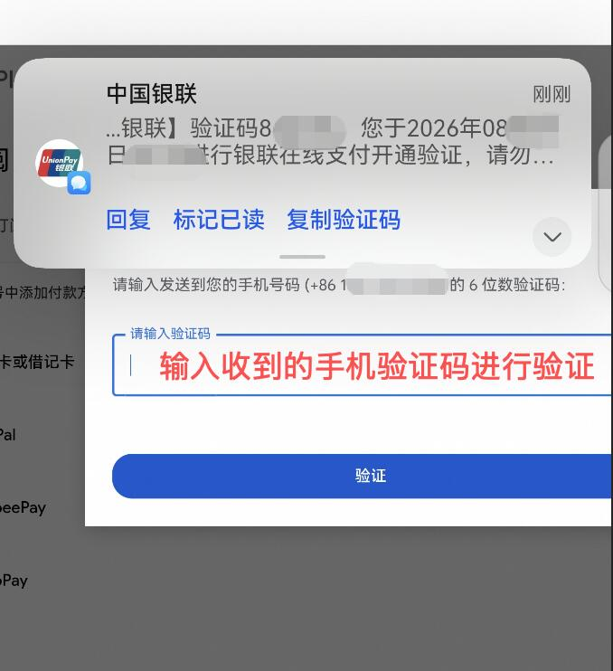

### 4. 下载 ChatGPT（华为用户）

华为用户这时候请回到【出境易】APP，如果没有的需要在应用市场下载；出境易里面搜索找到 ChatGPT 应用，下载（一定要连节点，没有节点的话无法下载境外应用）。

### 5. 订阅付款

打开 ChatGPT，登陆和 Google Play 一样的 Google 账号，在左侧对话栏找到右下角头像，点击进入，找到订阅 Plus 选项，点击，会跳转一个支付窗口，点击订阅并直接付款就可以啦～

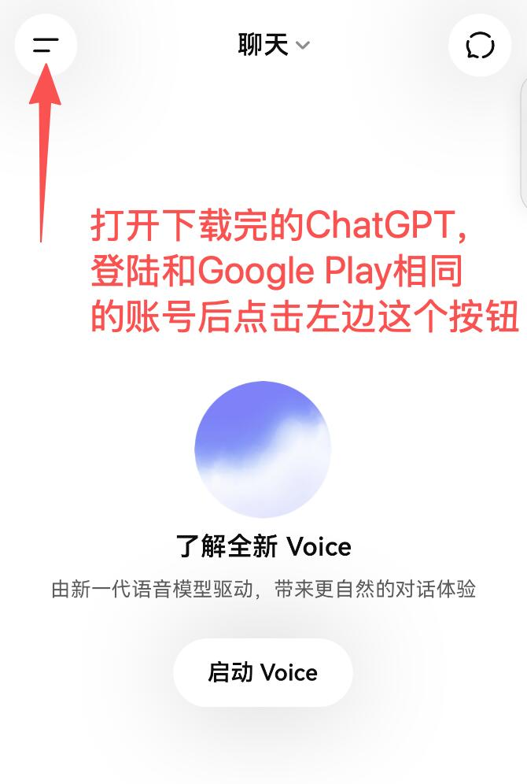

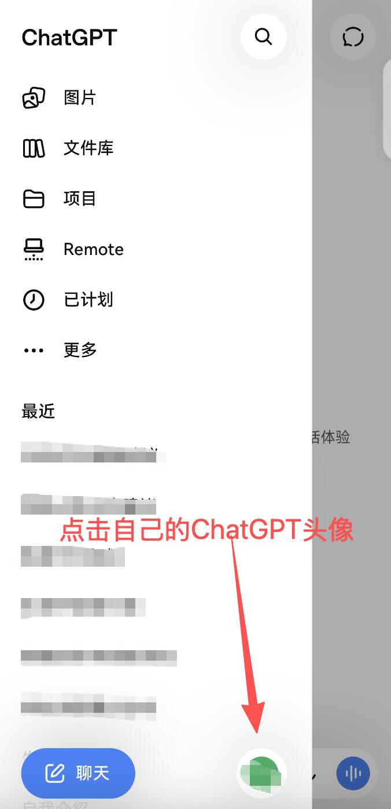

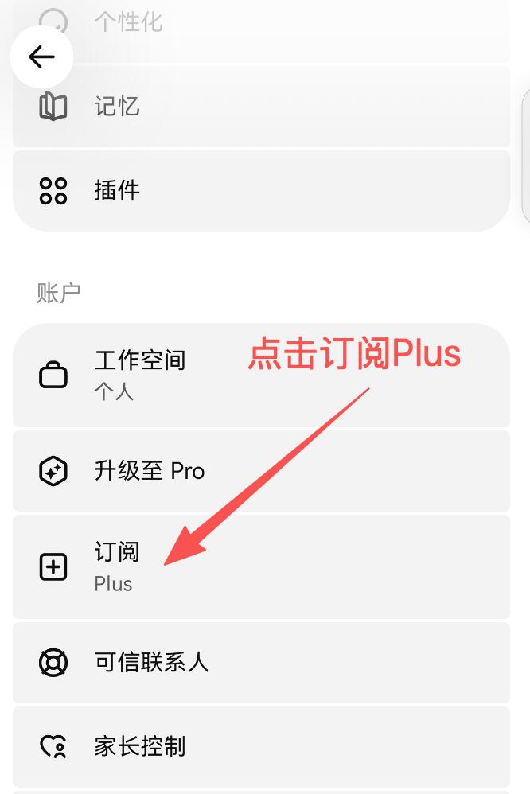

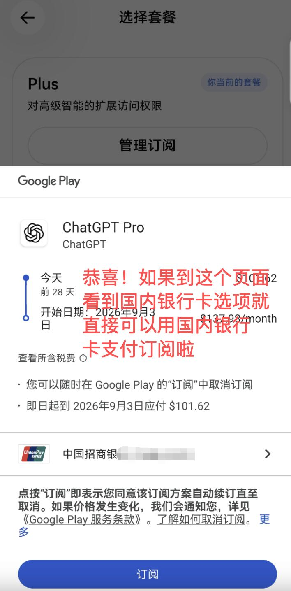

如果到支付页面看到国内银行卡选项，就直接可以用国内银行卡支付订阅啦。预祝大家订阅成功！

## 常见问题 FAQ

**Q：为什么必须全程开新加坡节点？**
因为 Google Play 的支付方式和商店内容跟着「当前访问地区 + 账号地区」走。节点中断或跳到其他地区，绑卡和付款步骤都可能失败，所以从登录到付款完成前不要断开。

**Q：银联卡绑定失败/验证码收不到怎么办？**
先确认是储蓄卡且开通了短信验证；部分银行对境外商户扣款默认关闭，需要在银行 App 里开启「境外支付」。换一张卡（建议大行借记卡）成功率更高。

**Q：扣款是人民币还是外币？会有汇率损失吗？**
Google Play 新加坡区按新币（SGD）计价，银联通道会自动换汇成人民币扣款，汇率按扣款当日银联牌价，会有小幅汇率差。

**Q：订阅会自动续费吗？怎么取消？**
会。Google Play 订阅默认每月自动扣款，取消入口在 Google Play →【付款和订阅】→【订阅】里，随时可以取消，取消后当期仍可用到期。

**Q：Play 账号地区不是新加坡怎么办？**
Google 账号地区一年只能改一次，且改区有条件限制。如果你的账号地区不在新加坡也不想折腾改区，直接看下面的省事方案。

## 嫌麻烦？还有更省事的路

这个方法需要稳定的新加坡节点、Play 账号地区恰好在新加坡，且 Google Play 订阅是美元/新币计价、自动续订。如果不满足条件或者想省事，用支付宝/微信付款的自助充值平台（如 [czgptai.com](https://www.czgptai.com/)）仍是门槛最低的选择：人民币固定价、买断不自动扣款、几分钟到账。

---

**相关阅读**：[ChatGPT/Claude/Codex 充值指南合集](https://github.com/CZGPT/chatgpt-chongzhi-guide) · 觉得有用请点个 ⭐ Star，有问题欢迎提 Issue。
- [ChatGPT充值 / ChatGPT代充平台对比 2026](https://czgpt.github.io/chatgpt-chongzhi-daichong-duibi/)
